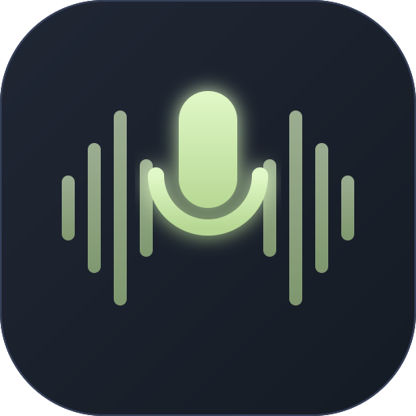

# PodEditor | Free Zero-Server Web Podcast Studio & Auto Silence Remover

<p align="center">
  
</p>

<p align="center">
  <strong>An ultra-minimal, 100% client-side web podcast studio built with Astro and React.</strong><br>
  Detect and strip dead air, apply professional vocal mastering, and export studio-ready audio directly in your browser with zero server uploads and total privacy.
</p>

<p align="center">
  <a href="https://podeditor.github.io"></a>
  <a href="https://ko-fi.com/kishara"></a>
  
  
</p>

---

## 🎙️ Overview

**PodEditor** is an ultra-minimal, high-performance, 100% private audio workstation engineered specifically for spoken-word podcasts, interviews, voiceovers, lectures, and YouTube creators. 

Unlike conventional cloud-based audio editors that require uploading sensitive, multi-gigabyte recordings to external remote servers, **PodEditor processes 100% of your audio directly in your local browser memory** using the **HTML5 Web Audio API** and **WebAssembly**. Your audio never leaves your machine, ensuring complete privacy, zero upload wait times, and zero subscription paywalls.

---

## 🚀 Key Features

### 🎛️ Real-Time RMS Silence Detection & Auto-Trimming
- **Silence Threshold (`-60dB` to `-20dB`)**: Accurately isolates background room tone and ambient floor noise from genuine vocal speech.
- **Max Silence Duration (`0.2s` to `2.5s`)**: Trims excessive pauses while retaining your exact chosen duration as natural breathing room between dialogue.
- **Natural Padding & 15ms Micro-Crossfades**: Protects word consonant attacks and sentence endings; applies smooth cosine crossfades to completely eradicate digital clicks and pops.
- **Live Motivating Metrics**: Displays real-time metrics including Original Duration, Edited Duration, Dead Air Stripped (in seconds and `%` saved), and Total Cuts Made.

### 🎨 High-Performance Interactive Waveform Canvas
- **Pre-Baked Offscreen Canvas**: Renders 2,000 waveform sample peaks at sub-millisecond speeds.
- **Interactive Cut Overlays**: Speech regions glow in Fresh Sage Lime (`#B7D894`), while detected dead air is highlighted in semi-transparent red cut boxes.
- **Click-to-Toggle Control**: Click directly on any highlighted silence region to instantly toggle between **Cut** (✂️) and **Keep** (🎧).
- **Smooth Scrubbing & Zoom**: Zoom smoothly from `1.0x` to `4.0x` for granular precision editing.

### ⚡ Non-Destructive Audition Preview
- **"Skip Silences" Mode**: Audition your cuts in real time. The playback transport seamlessly leaps forward across cut boundaries with zero audio latency.
- **Multi-Speed Audition**: Listen back at `1.0x`, `1.25x`, `1.5x`, or `2.0x` playback speeds.

### 🎙️ Pro Podcast Vocal Mastering (One-Click)
- **Podcast Voice Polish**:
  - **80Hz High-Pass Filter**: Eradicates desk thumps, HVAC rumble, and mic-stand vibrations.
  - **3kHz Vocal Presence Peaking EQ**: Adds clarity and intelligibility to speech.
  - **Gentle Dynamic Compressor**: Smooths out loud peaks and balances volume levels.
- **Auto-Level Volume Normalization**: Normalizes volume across multi-speaker interviews to broadcast standards (-1.0 dBFS true peak).

### 💾 Studio-Grade Client-Side Export
- **WAV Export**: Uncompressed 16-bit PCM lossless studio master.
- **MP3 Export**: Broadcast-standard 192kbps MP3 encoded via chunked `@breezystack/lamejs` directly in the browser at 15x–30x real-time speed.

### 📱 Progressive Web App (PWA) & Offline Studio
- **Add to Home Screen**: Install PodEditor as a standalone desktop or mobile application.
- **100% Offline Capable**: Powered by a Service Worker (`sw.js`) that caches all static assets, scripts, and audio encoders for offline fieldwork.

### 🌍 7-Language Global i18n
- Native localized routing with subpath architecture:
  - English (`en`, US) — `https://podeditor.github.io/`
  - Español (`es`, ES) — `https://podeditor.github.io/es`
  - Português (`pt`, BR) — `https://podeditor.github.io/pt`
  - Deutsch (`de`, DE) — `https://podeditor.github.io/de`
  - Français (`fr`, FR) — `https://podeditor.github.io/fr`
  - 日本語 (`ja`, JP) — `https://podeditor.github.io/ja`
  - 简体中文 (`zh`, CN) — `https://podeditor.github.io/zh`

---

## 🎨 Design System Palette

Built with a distraction-free, ultra-minimal studio aesthetic supporting seamless Light and Dark modes:

| Color Token | Hex Code | Purpose |
|---|---|---|
| **Deep Midnight Slate** | `#202734` | Dark mode canvas, high-contrast typography, primary buttons |
| **Muted Steel Navy** | `#36415A` | Secondary panels, control cards, unplayed waveform peaks |
| **Fresh Sage Lime** | `#B7D894` | Active waveforms, detected speech, primary accents |
| **Soft Mint Cream** | `#E0F8C7` | Elevated pills, hover highlights, subtle badges |
| **Light Canvas Background** | `#F9FCF6` | Default light studio background |

---

## 🏗️ Architecture & Signal Flow

```
[Local Audio File] (MP3 / WAV / M4A / OGG)
        │
        ▼
[Web Audio AudioContext] ───► In-Memory AudioBuffer
        │
        ├──► [RMS Energy Window Scanner (25ms)] ──► Real-Time Silence Regions
        │                                                     │
        ├──► [2,000-Point Peak Sampler]                       ▼
        │            │                            [Interactive Waveform Canvas]
        │            ▼                                 (Click-to-Toggle)
        │    [Offscreen Canvas (60fps)]
        │
        ▼
[Non-Destructive Playback Preview]
        │
        ├── [Skip Silences Jump Logic]
        └── [BiquadFilter (80Hz HPF + 3kHz EQ)] ──► [Audio Destination]
        │
        ▼
[OfflineAudioContext Render Pipeline]
        │
        ├── Concatenate Kept Speech Segments
        ├── 15ms Cosine Micro-Crossfades
        ├── Vocal Polish & Dynamics Compression
        └── Peak Volume Normalization (-1.0 dBFS)
        │
        ▼
[Client-Side Audio Encoders]
        │
        ├── WAV (16-bit PCM ArrayBuffer)
        └── MP3 (192kbps @breezystack/lamejs)
        │
        ▼
[Instant Browser File Download] (.wav / .mp3)
```

---

## 📁 Repository Structure

```
podeditor.github.io/
├── .github/
│   └── workflows/
│       └── deploy.yml            # Automated GitHub Pages CI/CD build & deployment
├── public/
│   ├── icon.svg                  # Vector application logo
│   ├── icon-192.png              # 192x192 PWA maskable icon
│   ├── icon-512.png              # 512x512 PWA splash icon
│   ├── manifest.webmanifest      # PWA installation manifest
│   ├── robots.txt                # Search engine crawler permissions
│   ├── sitemap.xml               # Multi-language sitemap with hreflang alternates
│   └── sw.js                     # Offline Service Worker cache
├── src/
│   ├── components/
│   │   ├── Footer.astro          # Site footer with i18n directory & developer badge
│   │   ├── MainPage.astro        # Localized studio container & SEO sections
│   │   ├── Navbar.astro          # Responsive navbar (icon-only on mobile, full on desktop)
│   │   └── PodcastStudio.tsx     # React Island: Canvas visualizer, Web Audio engine, transport
│   ├── i18n/
│   │   ├── locales/              # 7 localized translation JSON files
│   │   └── ui.ts                 # i18n types, constants, and translation helper
│   ├── layouts/
│   │   └── Layout.astro          # SEO metadata, Open Graph, hreflang & JSON-LD schemas
│   ├── pages/
│   │   ├── de/index.astro        # German route (/de)
│   │   ├── es/index.astro        # Spanish route (/es)
│   │   ├── fr/index.astro        # French route (/fr)
│   │   ├── ja/index.astro        # Japanese route (/ja)
│   │   ├── pt/index.astro        # Portuguese route (/pt)
│   │   ├── zh/index.astro        # Chinese route (/zh)
│   │   └── index.astro           # Root English route (/)
│   ├── styles/
│   │   └── global.css            # Tailwind directives and custom scrollbar rules
│   └── utils/
│       ├── audioEncoder.ts       # Client-side WAV and MP3 encoders
│       └── PodcastProcessor.ts   # Audio decoding, RMS detection, micro-fades, and mastering
├── astro.config.mjs              # Astro SSG configuration
├── package.json                  # Dependencies and build scripts
├── tailwind.config.mjs           # Custom color palette and font definitions
└── tsconfig.json                 # TypeScript strict configuration
```

---

## 🛠️ Getting Started

### Prerequisites
- **Node.js**: v18.0.0 or higher (v20+ recommended)
- **npm** or **pnpm** / **yarn**

### Local Installation
```bash
# 1. Clone the repository
git clone https://github.com/podeditor/podeditor.github.io.git
cd podeditor.github.io

# 2. Install dependencies
npm install

# 3. Start local development server
npm run dev
```

Visit `http://localhost:4321` in your browser.

### Production Build & Preview
```bash
# Build static site to /dist
npm run build

# Preview static production build locally
npm run preview
```

---

## 🌐 Supported Browsers

PodEditor leverages modern HTML5 Web Audio and WebAssembly APIs supported across all evergreen browsers:

| Browser | Minimum Version | Status |
|---|---|---|
| **Google Chrome** | 80+ | Fully Supported |
| **Mozilla Firefox** | 76+ | Fully Supported |
| **Apple Safari** | 14.1+ (macOS / iOS) | Fully Supported |
| **Microsoft Edge** | 80+ | Fully Supported |
| **Opera / Brave / Vivaldi** | Latest | Fully Supported |

---

## 🔒 Privacy & Security Guarantee

- **Zero Remote Uploads**: No audio data, filenames, or metrics are ever transmitted to any remote server or third-party analytics tracker.
- **Zero Account Requirement**: No login, API keys, or personal information required.
- **Ephemeral In-Memory Processing**: All audio buffers exist strictly in your browser session RAM and are purged upon page close.

---

## ☕ Support the Developer

PodEditor is completely free and open-source software built for independent podcast creators and audio storytellers. If it saves you hours of tedious editing, consider supporting ongoing development:

👉 **[Support on Ko-fi](https://ko-fi.com/kishara)**

---

## 📄 License

Distributed under the **MIT License**. Free for personal, educational, and commercial podcast production.
